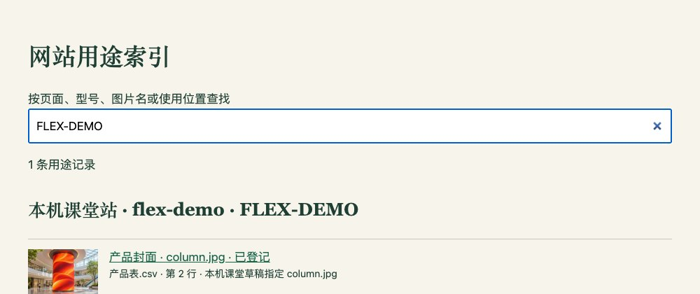

# 产品素材库 · Product Asset Library

把素材文件夹拖进 Codex，整理产品图片、视频和规格书。下次问“这个型号用哪张封面”或“换掉这张图会影响哪些页面”，Codex 可以直接查本地索引。

**[下载离线 HTML 分步教程](https://github.com/Miraclemin/product-asset-library/releases/download/v1.0.1/wordpress-tutorial.html)** · [阅读图文版](docs/从素材到WordPress草稿.md) · **[下载教学包 v1.0.1](https://github.com/Miraclemin/product-asset-library/releases/download/v1.0.1/product-asset-library-v1.0.1.zip)**

## 第一次用

1. 下载教学包并解压，在 Codex 桌面版打开解压后的文件夹。
2. 在对话框发送下面这句话，让 Codex 把 Skill 安装到你自己的技能目录。

   > 请把这个项目里 skills/product-asset-library 安装为我的个人 Codex Skill，保留它的 scripts 和 references。若已有同名版本，先告诉我版本差异。

3. 安装后新开一个素材整理对话，把包里的 **examples/LED-来稿** 文件夹拖进去并发送。第一次也可以说：“用 product-asset-library 整理这个文件夹。”
4. 点开返回的素材库，接着问：“FLEX-DEMO 的产品封面是哪张？依据是哪条？”

运行索引脚本需要 Python 3.9 或更新版本，只用标准库。Codex 负责查看素材、核对内容和调用脚本。Obsidian 可用于阅读生成的 Markdown 卡片。

## 你会得到什么

| 你要做的事 | 去哪里看 |
|---|---|
| 看某一类有哪些素材 | 素材库首页和品类卡 |
| 查某个型号、页面或图片的用途 | 用途索引，可按型号、页面、图片名搜索 |
| 查判定依据 | 用途记录中的原文件和行号或字段 |
| 把已确定的图交给建站工具 | 上传清单，一行写清素材、目标产品、页面和位置 |
| 定向更新 | 说出变更文件，Codex 只检查指定路径和受影响的用途 |

只有一批照片也能开始。素材里能看出的结构和品类会先归档，具体型号或网站用途缺少依据时列为待确认。只给文件夹做全量对账时，会枚举文件名，通过文件元数据跳过未变内容。

## 和 WordPress 配合

素材库记住“哪个文件属于哪个型号、放在哪个页面”。写入网站由另行配置的 WP Build / `wordpress-content` 完成，需要一个可写的练习站和对应的产品类型。仅体验素材整理、查询和增量更新时，只需要本仓库。

本次教程使用两张 AI 生成的 LED 示意图、虚构的教学型号和本机 WordPress 草稿。图片与产品表可在示例文件夹中逐项对照。[查看实际回执](docs/results/WordPress回执.json)
