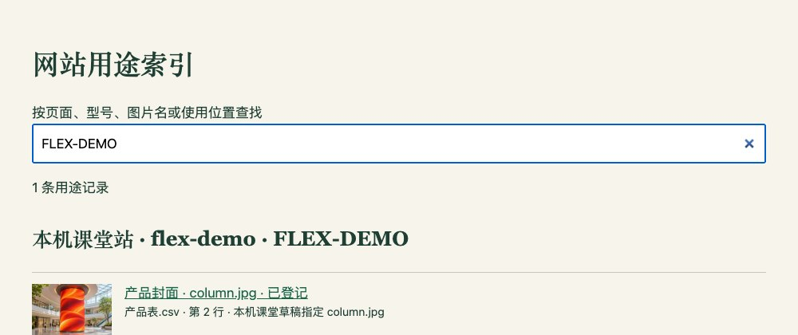
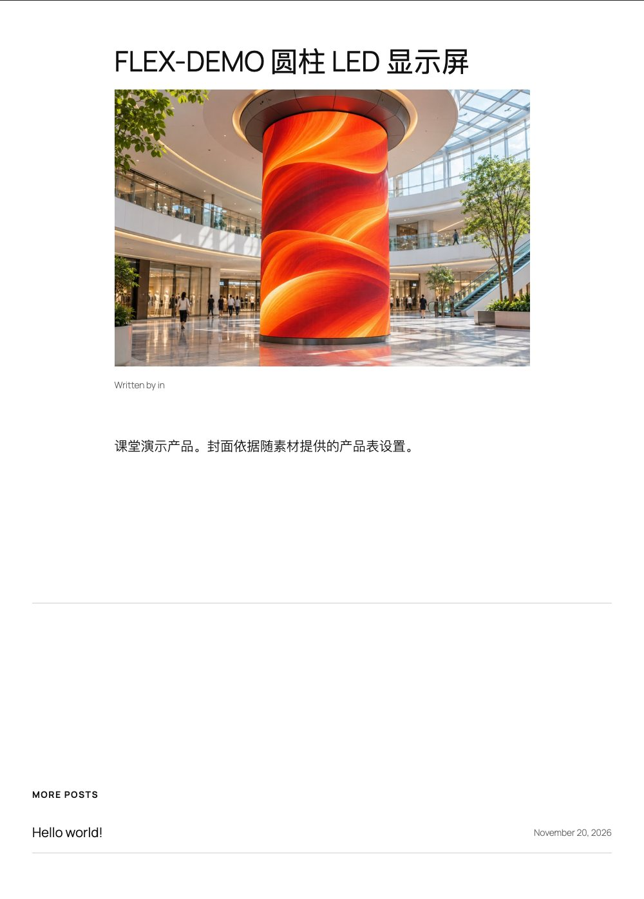

# 从一个素材文件夹到一张 WordPress 产品草稿

你收到三张 JPG 和一份产品表。要为 FLEX-DEMO 挑封面，先弄清哪张图能用，再亲眼确认它出现在产品页。下面每一步都附上可以对 Codex 说的话。[下载图片教学包](https://github.com/Miraclemin/product-asset-library/releases/download/v1.0.1/product-asset-library-v1.0.1.zip) · [安装为个人 Skill](../README.md#在自己的项目使用)

## 第一步　把整个来稿文件夹交给 Codex

安装好 Skill 后，打开 Codex 桌面版，在素材整理对话里拖入 **examples/LED-来稿** 文件夹并发送。可以补一句：

> 整理这个文件夹。给我看哪些图是重复的、哪张适合做已知产品的封面。

| 收到的文件 | 实际盘点结果 |
|---|---|
| column.jpg | 橙色画面包围圆柱，归为圆柱屏示意图。 |
| 销售转发.jpg | 文件内容与 column.jpg 完全一致，保留原文件，用同一份内容交接。 |
| stage.jpg | 舞台桁架下的吊装屏，可以按画面归类。第一批没有相应产品记录。 |
| 产品表.csv | 第 2 行指定 FLEX-DEMO 使用 column.jpg 作为产品封面，使用范围为本机课堂草稿。 |

这一步解决“文件名乱、同一张图由不同人发过来”的问题。Codex 看画面，再用文件指纹核对重复项。示例中的产品表已随素材提供。自己使用时，直接给原本就有的资料即可。[打开原始来稿](../examples/LED-来稿)

## 第二步　从型号查封面

> 查一下 FLEX-DEMO 的产品封面。给我文件名、用在哪个页面，以及判断依据。

本次查询返回一条记录：

| 型号 | 文件 | 页面标识 | 放哪里 | 凭什么这样选 |
|---|---|---|---|---|
| FLEX-DEMO | column.jpg | flex-demo | 产品封面 | 产品表.csv 第 2 行 |

“页面标识”是建站工具定位页面用的短名字。这条关系写进本地索引后，下次还能反过来问：“column.jpg 用在哪？” 如果客户只给照片，可以自己补一句“把这张图登记为 FLEX-DEMO 的产品封面”，让 Codex 把这次指定也记录下来。

[查看首次查询结果](results/首次查询.json)

## 第三步　把清单交给 WP Build

> 生成 FLEX-DEMO 的上传清单。用 WP Build 的 wordpress-content 读取清单，在我的本机 WordPress 练习站找到 flex-demo 对应的产品草稿；没有就新建一份草稿。把指定图片设为产品封面，保存后打开给我看。

先有一个已连接的本机练习站，并确认建站工具能写入产品草稿、设置特色图片。本次在单独的练习站里使用了支持特色图片的产品类型。如果只想学素材库，可以直接用下方的回执、截图核对这一步。

素材库给 WP Build 一行清单：**column.jpg → FLEX-DEMO → flex-demo → 产品封面**。建站工具把图片传入媒体库，拿到附件编号，再把这个编号填入产品草稿的封面字段。[看实际上传清单](results/上传清单.csv)

## 第四步　打开草稿，看图片是否真的挂对了

本次实跑新增了 **1 个媒体附件，编号为 4**。新建的 **产品草稿编号为 5**。再次读取草稿，封面字段是 **4**；打开草稿预览，页面加载了 column.jpg。重新执行同一笔图片上传，也拿到了附件 4。你自己练习时，编号由你的网站分配，以你实际看到的为准。

[看 WordPress 读回的草稿状态和附件编号](results/WordPress回执.json)

## 第五步　客户后来补了型号，只更新产品表

回到同一素材整理对话，说：

> 给来稿里的产品表追加一行：型号 RENT-DEMO，目标页面 rent-demo，位置为产品封面，素材 stage.jpg，用途范围为本机课堂草稿。只重新检查这份产品表，更新索引。最后分别查询 RENT-DEMO 和 FLEX-DEMO，这次只整理资料。

这次实跑检查了 **1 个路径、读取了 1 份文件、遍历目录 0 次**。更新后两条记录同时存在：FLEX-DEMO 继续用 column.jpg，RENT-DEMO 新增 stage.jpg。旧产品草稿仍是第四步的结果；第五步只更新了素材库。

如果客户只说“文件夹有变化”，把目录再发一次即可。Codex 会枚举文件找出增删改，再读取发生变化的内容。[看增量更新回执](results/增量更新.json)
